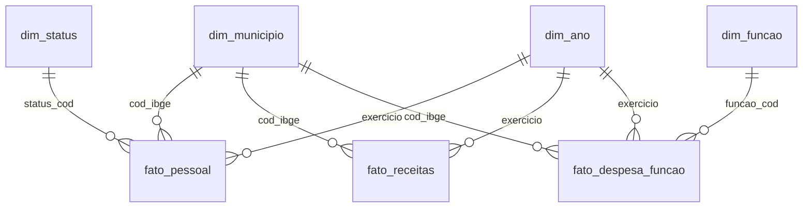

# Painel fiscal dos municípios de Goiás

Projeto de portfólio: pipeline de dados (Python + SQL com DuckDB) e painel (Power BI, em desenvolvimento) sobre a situação fiscal dos 246 municípios goianos, a partir dos dados abertos do Tesouro Nacional (Siconfi).

**Status:** em desenvolvimento. Concluído: despesa com pessoal frente aos limites da LRF, validação contra o DCA, receitas e despesa por função (2022 a 2025). Em andamento: modelo estrela e painel no Power BI.

## Perguntas que o projeto responde

- Quais municípios estão em alerta, no limite prudencial ou acima do limite de despesa com pessoal da LRF (alerta em 90%, prudencial em 95% e máximo de 54% da RCL ajustada para o Poder Executivo)?
- A situação melhora ou piora ao longo do tempo? A mudança vem da folha ou da receita?
- Como cada município se compara a pares de porte semelhante?
- (Em construção) Dependência de transferências e participação de saúde, educação e assistência social na despesa.

## Dados

- **Fonte:** API de dados abertos do Siconfi (apidatalake.tesouro.gov.br), endpoints `entes`, `rgf`, `dca` e `extrato_entregas`.
- **RGF (Relatório de Gestão Fiscal):** Anexo 01 para os municípios com relatório padrão e Anexo 06 (simplificado) conferido para os municípios com menos de 50 mil habitantes que optaram pelo formato simplificado.
- **Cobertura:** 246 municípios, exercícios de 2022 a 2025, fechamento do ano (3º quadrimestre; 2º semestre no formato simplificado). Apenas Poder Executivo.
- **DCA (Declaração de Contas Anuais):** anexos I-C (receitas), I-D (despesas) e I-E (despesas por função), 2022 a 2025, 246 municípios.

## Arquitetura

Python (coleta pela API) -> arquivos Parquet -> DuckDB (modelagem em SQL) -> Power BI (em desenvolvimento).

    src/siconfi.py      coleta (paginação, tentativas, retomada por lote)
    src/build_db.py     executa os scripts sql/NN_*.sql in ordem
    sql/                staging, dimensão de município e views
    sql/analises/       consultas analíticas (não fazem parte do build)

## Como reproduzir

Testado no Google Colab.

    pip install -r requirements.txt
    # 1) coletar: funções em src/siconfi.py (get_all, municipios_go, coletar_rgf, coletar_rgf_simplificado, coletar_dca)
    # 2) salvar a lista de municípios de GO em RAW_DIR/entes_go.parquet
    # 3) montar o banco:
    #    from src.build_db import build; con = build(raw_dir="data/raw")

## Modelo de dados

Esquema em estrela, materializado em DuckDB pelos scripts `sql/30_*` a `sql/42_*`.

- `fato_pessoal`: despesa com pessoal, limites da LRF, validação contra o DCA e comparação com pares do mesmo porte (mediana e posição percentual, calculadas sem os casos a revisar).
- `fato_receitas`: receitas por categoria, deduções e dependência de transferências.
- `fato_despesa_funcao`: despesa empenhada, liquidada e paga por função de governo.

## Qualidade dos dados

Os dados são autodeclarados pelos municípios. O projeto valida a RCL ajustada do RGF contra a receita do DCA (segunda fonte) e **sinaliza, sem corrigir nem excluir**, os casos atípicos.

- **Regra:** o par município-ano é marcado como "A revisar (dado atípico)" quando a despesa de pessoal passa de 100% da RCL ou quando a razão entre a RCL do RGF e a receita corrente líquida estimada a partir do DCA fica fora de 0,75 a 1,20. Os cortes são provisórios. Uma coluna à parte (`atencao_qualidade`) avisa quando a razão se afasta mais de 15% da razão típica do próprio município, sem alterar o status.
- **Razão típica:** a mediana da razão RGF/DCA fica entre 0,92 e 0,95 por ano, e 90% dos pares município-ano ficam entre 0,80 e 1,01. Ela não é 1,00 porque os conceitos de receita diferem (a RCL da LRF desconta mais itens que a estimativa feita a partir do DCA).
- **Casos marcados:** 23 dos 984 pares município-ano (4 em 2022, 7 em 2023, 4 em 2024 e 8 em 2025): 14 com RCL do RGF abaixo de 0,75 da receita do DCA e 9 acima de 1,20. Em 7 deles a despesa de pessoal declarada passa de 100% da RCL (razão entre 0,16 e 0,39).
- **RCL superdeclarada:** nos 9 casos com razão acima de 1,20, a RCL declarada supera até a receita corrente bruta do DCA (de 1,05 a 1,19 vez). Isso não se explica apenas pela dedução do FUNDEB, e a causa não foi identificada. Importa porque uma RCL superdeclarada pode esconder municípios acima do limite, e a regra atual só marca acima de 1,20.
- **Conferência interna:** nos municípios com RGF simplificado, o percentual de pessoal do Anexo 01 e o do Anexo 06 coincidem em 43 de 44 comparações (a outra difere em 0,11 ponto percentual).
- **Cobertura:** de 9 a 13 municípios por ano entregam o RGF simplificado (menos de 50 mil habitantes), coletado em endpoint e anexo próprios. Um município em 2024 não tem receita no DCA e ficou sem validação.

## Resultados preliminares

- **Situação em 2025 (246 municípios):** 165 regulares, 34 em alerta, 22 em prudencial, 17 acima do limite declarado e 8 a revisar. Em 2024: 190, 29, 15, 8 e 4.
- **Quem entrou acima do limite em 2025:** dos 17, 8 estavam regulares em 2024, 4 em alerta, 4 em prudencial e 1 já estava acima. Em sentido contrário, 6 dos 8 que estavam acima em 2024 aparecem como regulares em 2025.
- **Folha versus receita (mediana da variação anual, sem os casos a revisar):** 2023, RCL +8,9% e folha +13,7%; 2024, RCL +15,1% e folha +8,5%; 2025, RCL +11,1% e folha +14,5%.
- **Por porte:** em 2024, de 27% a 30% dos municípios de cada faixa tiveram folha crescendo mais que a RCL; em 2023, de 48% a 79%; em 2025, de 52% a 75%. O padrão se repete em todas as faixas, o que sugere um fator comum (não verificado).
- **Em 2025, entre os 17 acima do limite:** a folha subiu 25% ou mais em 13 (mediana de 28%), e a RCL teve mediana de +7,7%.
- **Reincidência:** 6 municípios ficaram acima do limite declarado em 2 ou mais anos.

## Limitações

- Dados autodeclarados. O extrato de entregas indica versões homologadas e retificadas do mesmo relatório, e a versão usada não foi identificada.
- Valores nominais, sem correção pela inflação.
- A receita do DCA usada na validação é uma estimativa (receitas correntes brutas menos deduções), não a RCL legal. O sinal das deduções varia entre municípios (algumas linhas vêm negativas), e o cálculo usa o valor absoluto.
- Os cortes de qualidade são provisórios e geram casos de fronteira (próximos de 0,75 ou 1,20).
- "Acima do limite" significa acima do limite **declarado** pelo município. Não é parecer de auditoria.
- Apenas Poder Executivo, no fechamento do ano.

## Próximos passos

- Modelo estrela e exportação para o Power BI.
- Painel: visão geral, comparação com pares por porte e aba de qualidade dos dados.
- Indicadores de dependência de transferências e de participação de saúde, educação e assistência na despesa.
- Investigar a RCL superdeclarada e a queda abrupta de 2024 para 2025.
- Incluir 2026.

## Licença e fonte

Dados públicos do Tesouro Nacional (Siconfi). Licença do código a definir.
